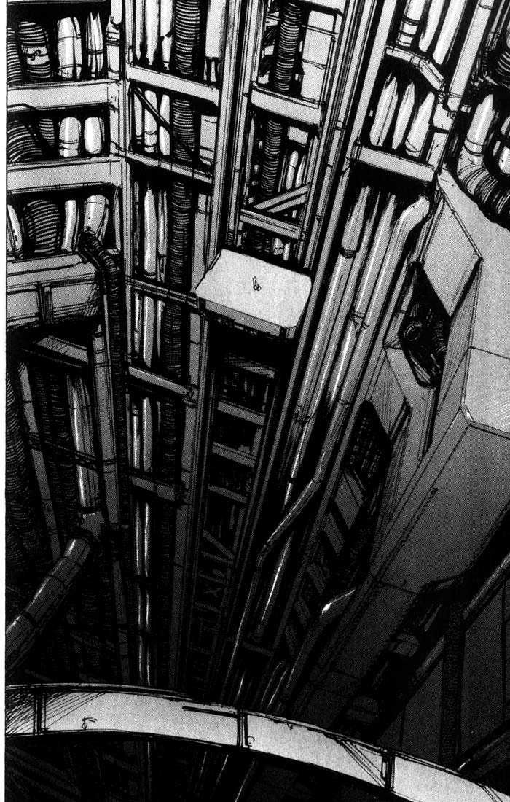

# About it


It's easy to see that this "game" is heavily inspired by my favorite manga, [Blame!](https://en.wikipedia.org/wiki/Blame!) by Tsutomu Nihei. I read a lot of books and a few comics, though I've read very little manga in my life. I stumbled across Blame! on a cyberpunk thread and was instantly mesmerized by the visuals of the Netsphere—an empty expanse that sometimes feels brutalist, and other times purely post-apocalyptic.

Blame! falls into that so-called "impossible to adapt" category of work. While I genuinely think that's true, I wanted to test the limits of Fable 5.2 (Anthropic's current frontier model as of November 2026). The result is far from perfect; at a quick glance, it might resemble Nihei's work, but the bottom line is:

  - Fable 5.2 is insanely impressive, considering this game was built from just four images and a ~20-line prompt. Most of the aesthetic was pulled simply from online descriptions of the Netsphere universe.
    
  - Still, even though Fable 5.2 did a phenomenal job, Tsutomu Nihei is impossible to replicate—not because of the visuals, but because of the unique experience his work gives the reader.



Megastructure as seen on the manga

# Glame! — playable demo

Open `index.html` in a desktop browser (double-click). Nothing to install.

| Action | Keys |
|--------|------|
| Walk | W A S D by key position (Z Q S D on an AZERTY keyboard), or the arrow keys |
| Look | Mouse (click the picture to capture it; if capture is refused, drag) |
| Run | Shift |
| Step back and see yourself | Hold Space or the right mouse button, or stand still for 8 seconds |
| Light | L |
| Level counter | H |
| Sound | M |

Add `?seed=1234` to the address to visit another world. The same seed always gives the same world.


Game Screenshot 1


Game Screenshot 2


Game screenshot 3

## Changing it

`index.html` is generated. Edit the files in `src/`, then run:

```
node build.mjs            # rebuilds index.html
node --test tests/*.test.mjs
```

- `src/world.js` — what exists where (heights, paths, megablocks, boxes)
- `src/render.js` — the picture (tones, hatching, outlines, haze)
- `src/walker.js`, `src/collide.js` — walking, stairs, falling
- `src/pullback.js` — the step-back camera
- `src/main.js`, `src/input.js`, `src/audio.js`, `src/page.html` — the rest

`tools/` holds headless-Chrome helpers for screenshots and browser checks; they need Playwright and are not needed to play.

Design and plan: `docs/`.
